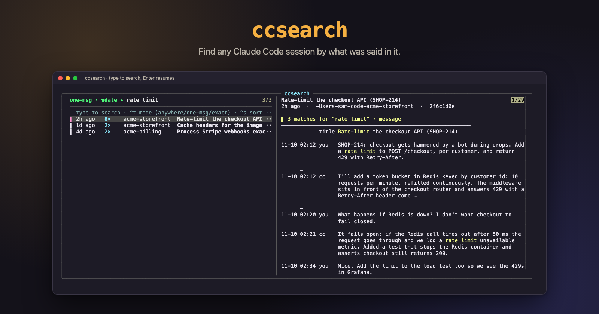
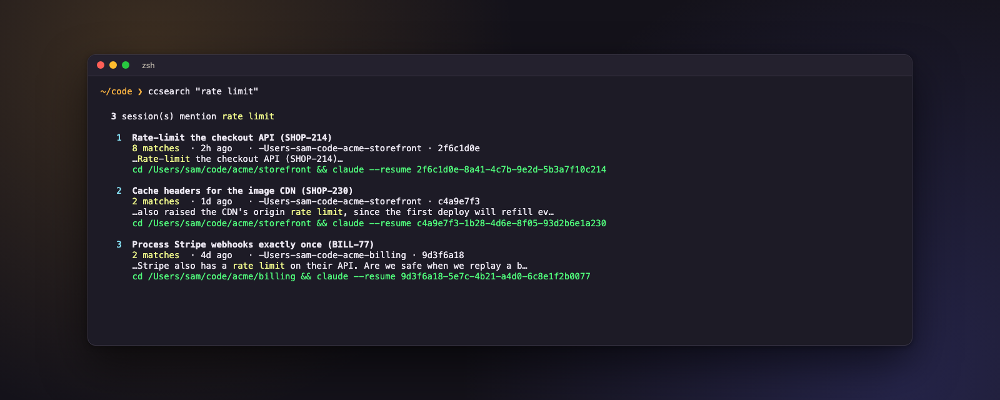

# ccsearch

Search your **Claude Code sessions by content** — find the chat that discussed a ticket,
PR, file, or idea weeks later, even after it drifted across topics. ccsearch reads the
actual conversation from your transcripts (never the JSON metadata) and gives you a fast
fuzzy browser with live preview and one-key resume.



## Install

```bash
brew install alex-yanchenko/tap/ccsearch   # macOS/Linux — also installs ripgrep + fzf
```

Prefer Python tooling? `uvx ccsearch` (run once) or `pipx install ccsearch` — then install
`ripgrep` and `fzf` yourself. Needs Python 3.9+.

## Use

```bash
ccsearch              # interactive browser: type to search, Enter resumes the session
ccsearch <keyword>    # list sessions mentioning <keyword>, ranked
ccsearch --index [N]  # summarize the N most-recent sessions (title + tickets)
```

In the browser: **Enter** resumes · **Ctrl-T** search mode (anywhere / one-message / exact)
· **Ctrl-S** sort (date ⇄ matches) · **Esc** quits.



The sessions in these images are invented. `bash scripts/render-images.sh` regenerates the images from `scripts/images/demo-sessions` with a throwaway cache, never reading your own sessions. It needs uv, Google Chrome, tmux, fzf and ripgrep, and fetches `ansi2html` through `uvx`; set `CHROME_PATH` if Chrome is not at its macOS location.

Zero config — it works out of the box. The first run caches your sessions under
`~/.cache/ccsearch` (plaintext, no network; `rm -rf` it anytime to reset).

## License

[PolyForm Noncommercial 1.0.0](./LICENSE) — free for noncommercial use.
